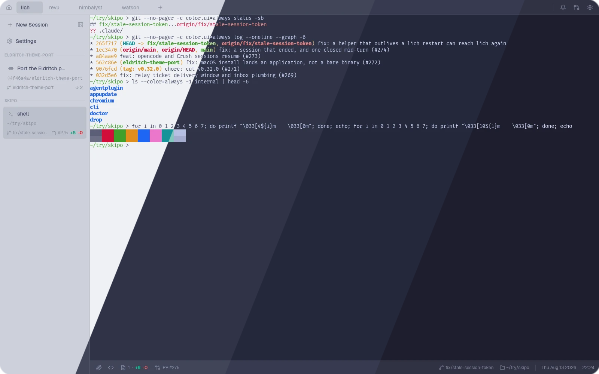
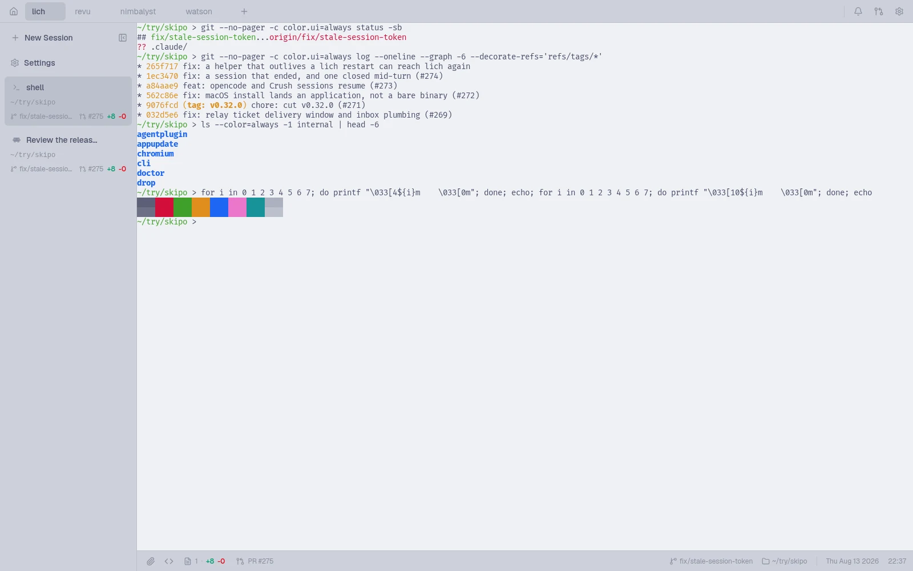
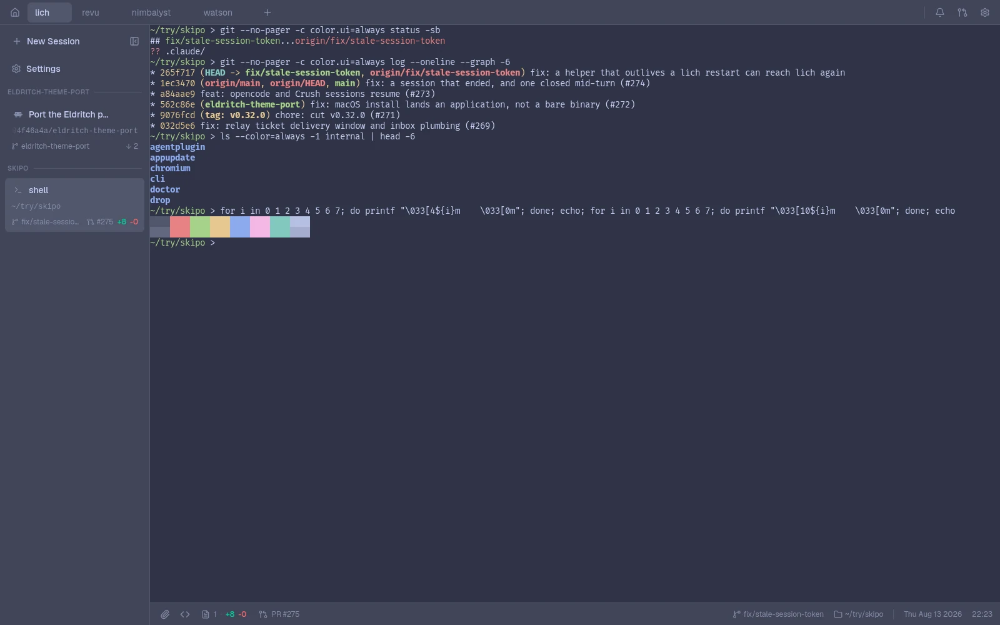
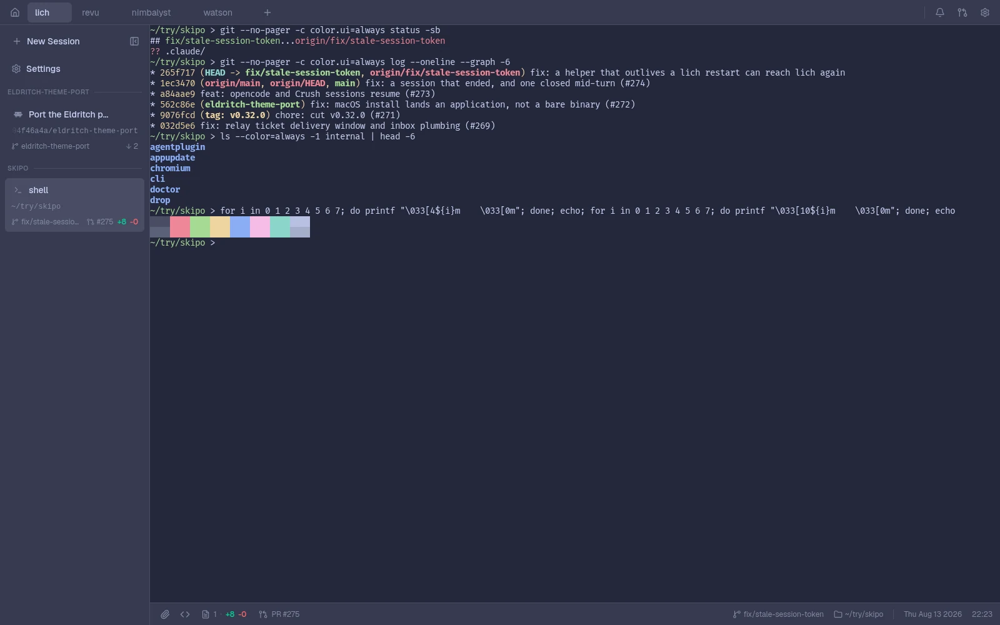
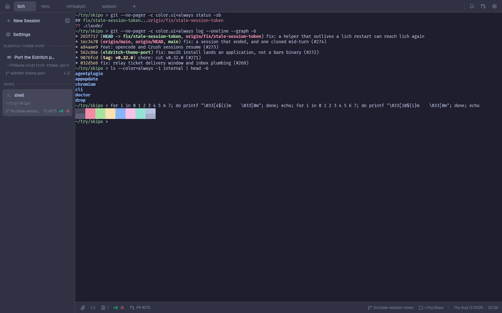

<h3 align="center">
	 
	
	Catppuccin for <a href="https://github.com/omartelo/lich">lich</a>
	
</h3>

	
	
	

	

## Previews

🌻 Latte

🪴 Frappé

🌺 Macchiato

🌿 Mocha

## Usage

1. Open lich and go to **Settings → Appearance**.
2. Next to **Theme**, click **Import**.
3. Paste `https://github.com/omartelo/catppuccin-lich` and click **Install**.
4. Pick a flavor in the theme picker.

lich installs the whole pack at once, so all four flavors land in the picker
together. Later releases are taken with **Update** on the theme's row.

## 🙋 FAQ

- Q: **_"The terminal panes and the interface can differ?"_**\
  A: They can. lich themes carry an interface palette and an xterm palette, and
  the terminal picker defaults to **Match app** — so one pick dresses both,
  unless you deliberately choose another flavor for the panes.

- Q: **_"Which lich tokens does the palette map onto?"_**\
  A: `base` is the app ground and the terminal background, `surface0` raises the
  chrome (cards, sidebar), `surface1` the floating layers, hover fills and
  borders, and `surface2` the input edges. `text` is the type, `overlay1` the
  secondary text, `mauve` fills `primary` and the focus ring, `red` is
  `destructive`, `green` and `yellow` are the `tone-pass` and `tone-wait` the
  status line speaks in, and the accents fill the charts and the sixteen ANSI
  slots. On Latte those two are darkened (`#29661b`, `#7c4f10`): the flavor's own
  values read 2.17:1 and 1.70:1 on its canvas, and the status line sets them at
  12px, where WCAG asks 4.5:1. Hue and saturation are the flavor's.

## 💝 Thanks to

- [omartelo](https://github.com/omartelo)

&nbsp;

	

	Copyright &copy; 2021-present <a href="https://github.com/catppuccin" target="_blank">Catppuccin Org</a>

	

